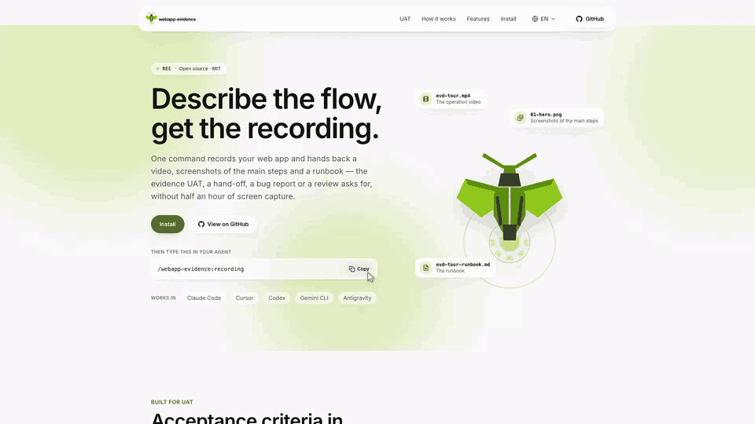
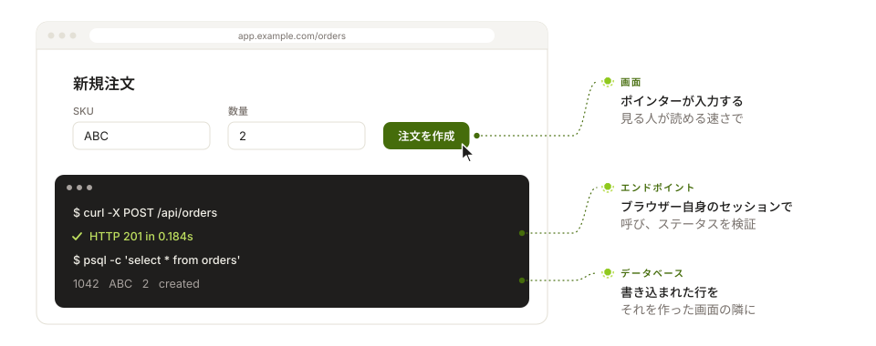
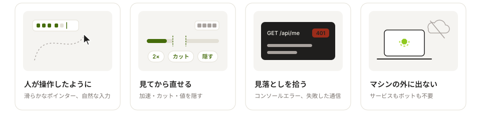
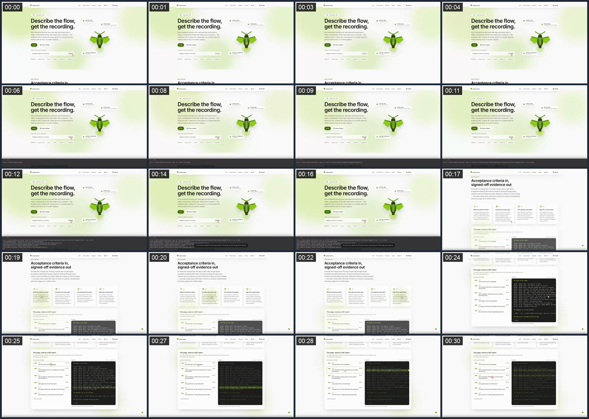
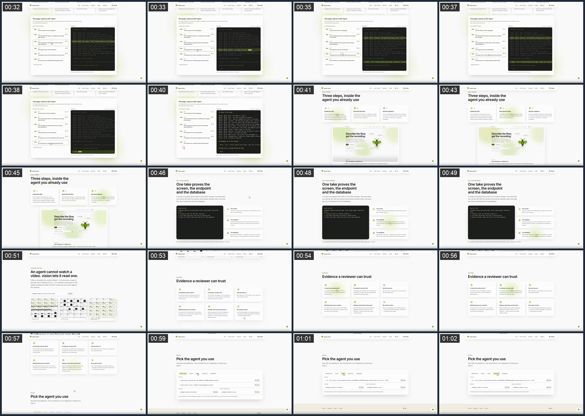
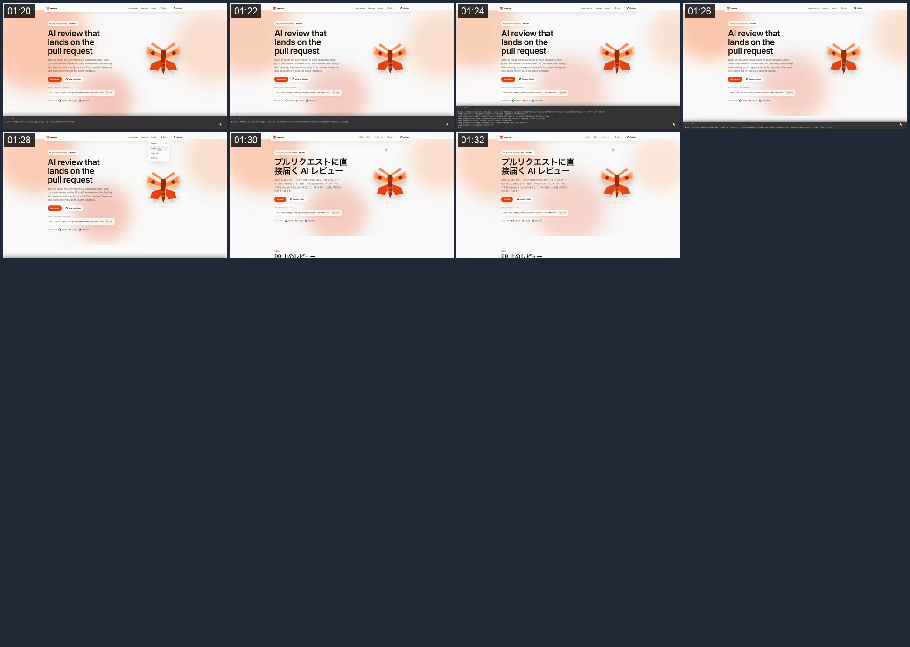

<p align="center">
  <picture>
    <source media="(prefers-color-scheme: dark)" srcset="./docs/images/logo/logo-lockup-dark.svg">
    
  </picture>
</p>

<h3 align="center">フローを伝えれば、録画が返ってくる。</h3>

<p align="center">
  <sub>
    <a href="./README.md">English</a> · <a href="./README.vi-VN.md">Tiếng Việt</a> · <strong>日本語</strong> · <a href="./README.zh-Hans.md">简体中文</a>
    &nbsp;&nbsp;|&nbsp;&nbsp; <a href="https://evdrec.vercel.app">evdrec.vercel.app</a> · <a href="./LICENSE">MIT</a>
  </sub>
</p>

<p align="center">
  <picture>
    <source media="(prefers-color-scheme: dark)" srcset="./docs/images/readme/pipeline.ja-JP-dark.svg">
    
  </picture>
</p>

<p align="center">
  <a href="https://evdrec.vercel.app"></a><br>
  <sub>このプロジェクト自身のランディングページを、紹介している skill そのもので録画。1 テイク、編集なし。</sub>
</p>

## 1 つのテイクが示せること

<p align="center">
  <picture>
    <source media="(prefers-color-scheme: dark)" srcset="./docs/images/readme/proofs.ja-JP-dark.svg">
    
  </picture>
</p>

```
/webapp-evidence:recording Page: https://app.example.com/orders
Flow:
1. Create an order for SKU ABC, quantity 2
2. Call POST /api/orders and show it answering 201
3. Query the orders table and show the row that appeared
```

<sub>Cookie はファイル経由で curl に渡り、コマンドラインには現れません。誤ったステータスは証拠になる前にテイク
を失敗させます。`recording.terminal.scrub` は一致した文字列だけを隠します。</sub>

## UAT のために

<p align="center">
  <picture>
    <source media="(prefers-color-scheme: dark)" srcset="./docs/images/readme/uat.ja-JP-dark.svg">
    
  </picture>
</p>

<p align="center"><sub>上の録画は、このループをプロジェクト自身のサイトで回したものです:
<a href="https://evdrec.vercel.app">evdrec.vercel.app</a> は自分のテイクを UAT 報告書として読み返します。</sub></p>

## 頼まなくても

<p align="center">
  <picture>
    <source media="(prefers-color-scheme: dark)" srcset="./docs/images/readme/traits.ja-JP-dark.svg">
    
  </picture>
</p>

<details>
<summary><b>runbook の中身</b> — 上のテイクを、受け取った人が読む形で</summary>

```markdown
## Steps in the video

00:05 - 00:17  Terminal — the SEO meta the page serves, read off its URL
00:24 - 00:40  UAT report — each criterion picks out the runbook lines that prove it
00:58 - 01:06  Install — one panel per agent

## Commands run in the terminal

- 00:12  `curl -s https://evdrec.vercel.app/ | grep -oE '<title>[^<]*</title>|…'` — exit 0

## Page errors recorded during the take

- none
```

</details>

## テイクを読み返す

エージェントは動画を見られません。`vision` は動画を `mm:ss` 付きのシートに並べるので、指摘は
*「00:14 でヘッダーが表に重なっている」* という形で返ってきます。

<p align="center">
  <a href="./docs/demo/vision-sheet-01.png"></a>
  <a href="./docs/demo/vision-sheet-02.png"></a>
  <a href="./docs/demo/vision-sheet-03.png"></a>
</p>

## インストール

<p align="center">
  <picture>
    <source media="(prefers-color-scheme: dark)" srcset="./docs/images/readme/platforms.ja-JP-dark.svg">
    
  </picture>
</p>

**Claude Code**

```bash
claude plugin marketplace add TOMOSIA-VIETNAM/webapp-evidence
claude plugin install webapp-evidence@webapp-evidence
```

**Cursor, Codex, Gemini CLI, Antigravity**

```bash
curl -fsSL https://raw.githubusercontent.com/TOMOSIA-VIETNAM/webapp-evidence/main/install.sh | bash
```

Chrome、ffmpeg、Node が必要です。足りないものはエージェントが名前を挙げてインストールを申し出ます。
あとは Claude Code で `/webapp-evidence:recording`、Cursor・Gemini CLI・Antigravity で
`/webapp-evidence-recording`、Codex で `$webapp-evidence-recording` と打つだけです。

<details>
<summary><b>リリースの固定・更新・削除</b></summary>

```bash
curl -fsSL https://raw.githubusercontent.com/TOMOSIA-VIETNAM/webapp-evidence/main/install.sh | bash -s -- --ref v1.1.3
```

`--ref main` はブランチを追い、`--ref latest` はリリース追従に戻します。以降の実行は最後に指定したも
のを保ちます。更新は `~/.webapp-evidence/scripts/install-local.sh --update`、削除は
`--uninstall --all`。

</details>

## 頼み方

覚える構文はありません。*「さっき直した画面のエビデンスを撮って」* で通じます。言語も問いません。

| やりたいこと | 打つもの |
|---|---|
| 直したばかりの画面 | `/webapp-evidence:recording` |
| MR / PR | `/webapp-evidence:recording https://gitlab.example.com/group/admin/-/merge_requests/1783` |
| データが変わった後にもう一度 | `record that again` — 古いテイクは `v1`、`v2`… として残ります |
| ゆっくり、または別の言語の字幕 | `record it slower`、`captions in Japanese` — プロジェクトごとに覚えます |
| 撮り終えたテイクを直す | `cover the API key in step 3`、`twice as fast` |
| ドロップダウンやダイアログを映す | `--screen` — ブラウザーウィンドウを録ります |
| 画面を使わない | `--headless` — 既定 |
| gif や webm | `-f gif`、`-f webm` — それ以外は mp4 |
| 動画に何が映っているか | `/webapp-evidence:vision <the mp4>` |
| ログイン済みの状態から始める | `set up the evidence config for this project` |
| 問題を伝える | `/webapp-evidence:feedback` |

## 制限

録るのはページで、画面ではありません。`<select>` のメニュー、ファイル選択、`confirm`/`alert` は字幕とス
クリーンショットで代わりに記録されます。映す必要があれば `--screen` で、エージェントが先に確認します。
ターミナルパネルは行単位の出力のみで、`vim`、`less`、`htop` は使えません。

---

<sub>ここの図はすべて `docs/images/readme/build-readme-art.py` が描いています。録画は `webapp/` に対して
`docs/demo/record.sh` を実行したものです。skill 自体の開発は **[CONTRIBUTING.md](./CONTRIBUTING.md)**
を参照してください。</sub>
