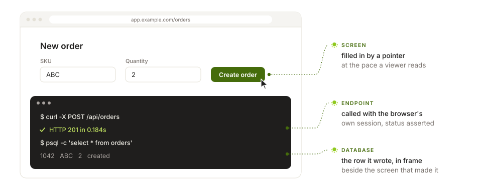
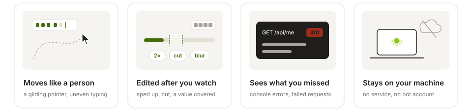

<p align="center">
  <picture>
    <source media="(prefers-color-scheme: dark)" srcset="./docs/images/logo/logo-lockup-dark.svg">
    
  </picture>
</p>

<h3 align="center">Describe the flow. Get the recording.</h3>

<p align="center">
  <sub>
    <strong>English</strong> · <a href="./README.vi-VN.md">Tiếng Việt</a> · <a href="./README.ja-JP.md">日本語</a> · <a href="./README.zh-Hans.md">简体中文</a>
    &nbsp;&nbsp;|&nbsp;&nbsp; <a href="https://evdrec.vercel.app">evdrec.vercel.app</a> · <a href="./LICENSE">MIT</a>
  </sub>
</p>

<p align="center">
  <picture>
    <source media="(prefers-color-scheme: dark)" srcset="./docs/images/readme/pipeline-dark.svg">
    
  </picture>
</p>

<p align="center">
  <a href="https://evdrec.vercel.app"></a><br>
  <sub>This project's own landing page, recorded by the skill it describes. One take, no editing.</sub>
</p>

## What one take proves

<p align="center">
  <picture>
    <source media="(prefers-color-scheme: dark)" srcset="./docs/images/readme/proofs-dark.svg">
    
  </picture>
</p>

```
/webapp-evidence:recording Page: https://app.example.com/orders
Flow:
1. Create an order for SKU ABC, quantity 2
2. Call POST /api/orders and show it answering 201
3. Query the orders table and show the row that appeared
```

<sub>Cookies and tokens reach curl through a file, so they're never typed on the command line. The step
asserts the status: a wrong one fails the take rather than shipping as evidence. And nothing gets redacted
on its own: a pattern in `recording.terminal.scrub` replaces only the text it matches.</sub>

## Built for UAT

<p align="center">
  <picture>
    <source media="(prefers-color-scheme: dark)" srcset="./docs/images/readme/uat-dark.svg">
    
  </picture>
</p>

<p align="center"><sub>The recording above is that loop, run on this project's own site:
<a href="https://evdrec.vercel.app">evdrec.vercel.app</a> reads its take back as a UAT report.</sub></p>

## And without being asked

<p align="center">
  <picture>
    <source media="(prefers-color-scheme: dark)" srcset="./docs/images/readme/traits-dark.svg">
    
  </picture>
</p>

<details>
<summary><b>What a runbook looks like</b> — the take above, as the person on the other end reads it</summary>

```markdown
## Steps in the video

00:05 - 00:17  Terminal — the SEO meta the page serves, read off its URL
00:24 - 00:40  UAT report — each criterion picks out the runbook lines that prove it
00:58 - 01:06  Install — one panel per agent

## Commands run in the terminal

- 00:12  `curl -s https://evdrec.vercel.app/ | grep -oE '<title>[^<]*</title>|…'` — exit 0

## Page errors recorded during the take

- none
```

</details>

## Read a take back

An agent cannot watch a video. `vision` tiles one into contact sheets — frames at a steady interval,
each stamped `mm:ss` — so a finding comes back as *"the header overlaps the table at 00:14"*, a timestamp
you can check against the runbook. The take above, as the agent reads it:

<p align="center">
  <a href="./docs/demo/vision-sheet-01.png"></a>
  <a href="./docs/demo/vision-sheet-02.png"></a>
  <a href="./docs/demo/vision-sheet-03.png"></a>
</p>

## Install

<p align="center">
  <picture>
    <source media="(prefers-color-scheme: dark)" srcset="./docs/images/readme/platforms-dark.svg">
    
  </picture>
</p>

**Claude Code**

```bash
claude plugin marketplace add TOMOSIA-VIETNAM/webapp-evidence
claude plugin install webapp-evidence@webapp-evidence
```

**Cursor, Codex, Gemini CLI, Antigravity**

```bash
curl -fsSL https://raw.githubusercontent.com/TOMOSIA-VIETNAM/webapp-evidence/main/install.sh | bash
```

It asks which platform you use, then tells you where everything landed. Recording needs Chrome, ffmpeg,
and Node — the agent names anything missing and offers to install it.

Where you type the command depends on the platform: `/webapp-evidence:recording` in Claude Code,
`/webapp-evidence-recording` in Cursor, Gemini CLI and Antigravity, `$webapp-evidence-recording` in
Codex.

While a take records, the runner asks `gh` whether your GitHub account has starred this repository,
until it gets an answer. If it has not, the agent asks you once, at the end, whether to star it —
nothing is written to GitHub unless you say yes. `STAR_CHECK=0` turns the check off.

<details>
<summary><b>Pin a release, update, uninstall</b></summary>

```bash
curl -fsSL https://raw.githubusercontent.com/TOMOSIA-VIETNAM/webapp-evidence/main/install.sh | bash -s -- --ref v1.1.3
```

`--ref main` follows the branch and `--ref latest` follows the latest release; every later run stays on
whichever was asked for last. Update with `~/.webapp-evidence/scripts/install-local.sh --update`,
remove with `--uninstall --all`.

</details>

## Ways to ask

No syntax to learn. *"Get evidence for the screen I just fixed"* works — write it in any language, and
the agent answers in that language.

| You want | Type this |
|---|---|
| Evidence for the screen you just changed | `/webapp-evidence:recording` |
| Evidence for an MR or PR | `/webapp-evidence:recording https://gitlab.example.com/group/admin/-/merge_requests/1783` |
| The same take again, after the data changed | `record that again` — old takes kept as `v1`, `v2`, … |
| A slower take, or captions in another language | `record it slower`, `captions in Japanese` — remembered per project |
| Edit a finished take | `cover the API key in step 3`, `twice as fast` |
| The OS dropdown or dialog, in frame | `--screen` — records the browser window |
| Never touch the screen, whatever the flow | `--headless` — the default |
| A gif for a README, a webm for a page you control | `-f gif`, `-f webm` — mp4 otherwise |
| Know what a video shows, without watching it | `/webapp-evidence:vision <the mp4>` |
| Takes that start already signed in | `set up the evidence config for this project` |
| Report a problem | `/webapp-evidence:feedback` |

## Limits

It records the page, not your screen: `<select>` menus, the file picker, and `confirm`/`alert` get a
caption plus a screenshot instead — or use `--screen`, which asks first. The terminal panel takes
line-oriented output, so `vim`, `less`, and `htop` are out.

---

<sub>Every picture here is drawn by `docs/images/readme/build-readme-art.py`; the recording is
`docs/demo/record.sh` run on `webapp/`. To work on the skill itself, see
**[CONTRIBUTING.md](./CONTRIBUTING.md)**.</sub>
