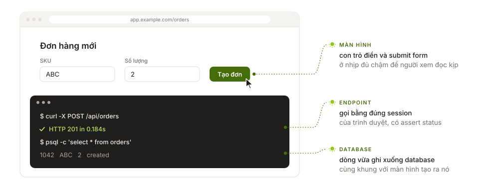
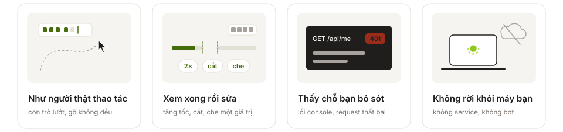

<p align="center">
  <picture>
    <source media="(prefers-color-scheme: dark)" srcset="./docs/images/logo/logo-lockup-dark.svg">
    
  </picture>
</p>

<h3 align="center">Mô tả luồng. Nhận về bản quay.</h3>

<p align="center">
  <sub>
    <a href="./README.md">English</a> · <strong>Tiếng Việt</strong> · <a href="./README.ja-JP.md">日本語</a> · <a href="./README.zh-Hans.md">简体中文</a>
    &nbsp;&nbsp;|&nbsp;&nbsp; <a href="https://evdrec.vercel.app">evdrec.vercel.app</a> · <a href="./LICENSE">MIT</a>
  </sub>
</p>

<p align="center">
  <picture>
    <source media="(prefers-color-scheme: dark)" srcset="./docs/images/readme/pipeline.vi-VN-dark.svg">
    
  </picture>
</p>

<p align="center">
  <a href="https://evdrec.vercel.app"></a><br>
  <sub>Trang landing của chính dự án này, được quay bởi đúng skill mà nó giới thiệu. Một lần quay duy nhất, không cắt ghép.</sub>
</p>

## Một bản quay chứng minh được gì

<p align="center">
  <picture>
    <source media="(prefers-color-scheme: dark)" srcset="./docs/images/readme/proofs.vi-VN-dark.svg">
    
  </picture>
</p>

```
/webapp-evidence:recording Page: https://app.example.com/orders
Flow:
1. Create an order for SKU ABC, quantity 2
2. Call POST /api/orders and show it answering 201
3. Query the orders table and show the row that appeared
```

<sub>Cookie và token được truyền cho curl qua file, nên không bao giờ bị gõ lộ trên dòng lệnh. Bước gọi
endpoint có assert status: sai là hỏng bản quay, chứ không lọt ra ngoài thành "bằng chứng". Pattern trong
`recording.terminal.scrub` chỉ thay đúng phần nó khớp.</sub>

## Sinh ra cho UAT

<p align="center">
  <picture>
    <source media="(prefers-color-scheme: dark)" srcset="./docs/images/readme/uat.vi-VN-dark.svg">
    
  </picture>
</p>

<p align="center"><sub>Bản quay ở trên chính là vòng đó, chạy ngay trên site của dự án:
<a href="https://evdrec.vercel.app">evdrec.vercel.app</a> đọc lại bản quay của chính nó như một báo cáo UAT.</sub></p>

## Và không cần ai nhắc

<p align="center">
  <picture>
    <source media="(prefers-color-scheme: dark)" srcset="./docs/images/readme/traits.vi-VN-dark.svg">
    
  </picture>
</p>

<details>
<summary><b>Runbook trông thế nào</b> — bản quay ở trên, đúng như người nhận đọc nó</summary>

```markdown
## Steps in the video

00:05 - 00:17  Terminal — the SEO meta the page serves, read off its URL
00:24 - 00:40  UAT report — each criterion picks out the runbook lines that prove it
00:58 - 01:06  Install — one panel per agent

## Commands run in the terminal

- 00:12  `curl -s https://evdrec.vercel.app/ | grep -oE '<title>[^<]*</title>|…'` — exit 0

## Page errors recorded during the take

- none
```

</details>

## Đọc lại một bản quay

Agent không xem được video. `vision` bẻ video thành các contact sheet — khung hình cách đều, mỗi khung
đóng dấu `mm:ss` — nên một lỗi hiển thị sẽ quay về dạng *"header đè lên bảng ở 00:14"*, đúng mốc bạn đối
chiếu được với runbook. Đây là bản quay ở trên, nhìn theo cách agent đọc nó:

<p align="center">
  <a href="./docs/demo/vision-sheet-01.png"></a>
  <a href="./docs/demo/vision-sheet-02.png"></a>
  <a href="./docs/demo/vision-sheet-03.png"></a>
</p>

## Cài đặt

<p align="center">
  <picture>
    <source media="(prefers-color-scheme: dark)" srcset="./docs/images/readme/platforms.vi-VN-dark.svg">
    
  </picture>
</p>

**Claude Code**

```bash
claude plugin marketplace add TOMOSIA-VIETNAM/webapp-evidence
claude plugin install webapp-evidence@webapp-evidence
```

**Cursor, Codex, Gemini CLI, Antigravity**

```bash
curl -fsSL https://raw.githubusercontent.com/TOMOSIA-VIETNAM/webapp-evidence/main/install.sh | bash
```

Nó hỏi bạn dùng nền tảng nào, rồi báo rõ mọi thứ nằm ở đâu. Để quay cần Chrome, ffmpeg và Node — thiếu
cái nào, agent gọi đúng tên cái đó và đề nghị cài giúp.

Gõ lệnh ở đâu tuỳ nền tảng: `/webapp-evidence:recording` trong Claude Code, `/webapp-evidence-recording`
trong Cursor, Gemini CLI và Antigravity, `$webapp-evidence-recording` trong Codex.

Trong lúc quay, runner hỏi `gh` xem tài khoản GitHub của bạn đã star repo này chưa, cho đến khi có
câu trả lời. Nếu chưa, cuối cùng agent hỏi bạn đúng một lần có muốn star không — không có gì được
ghi lên GitHub nếu bạn không đồng ý. Đặt `STAR_CHECK=0` để tắt việc kiểm tra này.

<details>
<summary><b>Muốn ghim một release hoặc bám theo branch, cập nhật, gỡ cài đặt</b></summary>

```bash
curl -fsSL https://raw.githubusercontent.com/TOMOSIA-VIETNAM/webapp-evidence/main/install.sh | bash -s -- --ref v1.1.3
```

`--ref main` bám theo branch, `--ref latest` quay về nhánh release mới nhất; những lần chạy sau giữ
nguyên lựa chọn gần nhất. Cập nhật bằng `~/.webapp-evidence/scripts/install-local.sh --update`, gỡ
bằng `--uninstall --all`.

</details>

## Các kiểu yêu cầu

Không có cú pháp nào phải học. Cứ nói *"Lấy evidence cho màn hình tôi vừa sửa"* là chạy — viết bằng tiếng
nào, agent trả lời bằng tiếng đó.

| Bạn muốn | Gõ thế này |
|---|---|
| Lấy evidence cho màn hình vừa sửa | `/webapp-evidence:recording` |
| Lấy evidence cho một MR/PR | `/webapp-evidence:recording https://gitlab.example.com/group/admin/-/merge_requests/1783` |
| Dữ liệu đổi, muốn quay lại đúng bản đó | `record that again` — bản cũ giữ thành `v1`, `v2`, … |
| Muốn quay chậm lại, hoặc caption tiếng khác | `record it slower`, `captions in Japanese` — nhớ theo từng project |
| Xem xong muốn chỉnh lại bản quay | `cover the API key in step 3`, `twice as fast` |
| Muốn dropdown/dialog của hệ điều hành cũng vào khung hình | `--screen` — quay cửa sổ trình duyệt |
| Không muốn động tới màn hình, dù luồng nào | `--headless` — mặc định |
| Muốn gif cho README, webm cho trang tự host | `-f gif`, `-f webm` — còn lại là mp4 |
| Muốn biết video có gì mà khỏi phải xem | `/webapp-evidence:vision <the mp4>` |
| Muốn bản quay bắt đầu ở trạng thái đã đăng nhập | `set up the evidence config for this project` |
| Thấy sai hoặc thiếu gì, muốn báo | `/webapp-evidence:feedback` |

## Giới hạn

Nó quay trang web, không quay màn hình máy bạn — nên thứ hệ điều hành vẽ sẽ nằm ngoài: dropdown
`<select>`, hộp chọn file, `confirm`/`alert` được thay bằng caption kèm screenshot. Muốn lấy cả những thứ
đó thì dùng `--screen`, agent sẽ hỏi trước. Panel terminal nhận output theo từng dòng, nên `vim`, `less`,
`htop` không xài được.

---

<sub>Mọi hình ở đây được vẽ bởi `docs/images/readme/build-readme-art.py`; còn bản quay là
`docs/demo/record.sh` chạy trên `webapp/`. Muốn đóng góp cho chính skill này, xem
**[CONTRIBUTING.md](./CONTRIBUTING.md)**.</sub>
