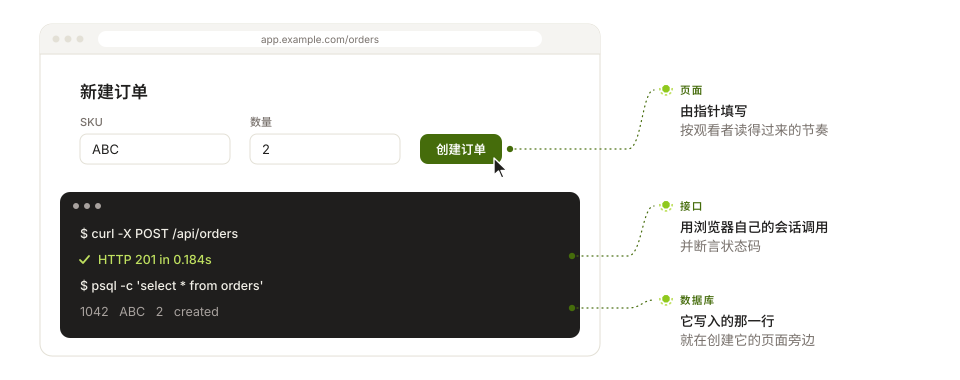
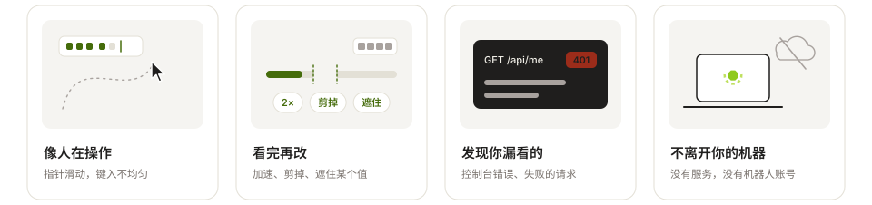

<p align="center">
  <picture>
    <source media="(prefers-color-scheme: dark)" srcset="./docs/images/logo/logo-lockup-dark.svg">
    
  </picture>
</p>

<h3 align="center">描述流程，拿回录制。</h3>

<p align="center">
  <sub>
    <a href="./README.md">English</a> · <a href="./README.vi-VN.md">Tiếng Việt</a> · <a href="./README.ja-JP.md">日本語</a> · <strong>简体中文</strong>
    &nbsp;&nbsp;|&nbsp;&nbsp; <a href="https://evdrec.vercel.app">evdrec.vercel.app</a> · <a href="./LICENSE">MIT</a>
  </sub>
</p>

<p align="center">
  <picture>
    <source media="(prefers-color-scheme: dark)" srcset="./docs/images/readme/pipeline.zh-Hans-dark.svg">
    
  </picture>
</p>

<p align="center">
  <a href="https://evdrec.vercel.app"></a><br>
  <sub>本项目自己的落地页，由它介绍的 skill 亲自录制。一次录制，没有剪辑。</sub>
</p>

## 一次录制能证明什么

<p align="center">
  <picture>
    <source media="(prefers-color-scheme: dark)" srcset="./docs/images/readme/proofs.zh-Hans-dark.svg">
    
  </picture>
</p>

```
/webapp-evidence:recording Page: https://app.example.com/orders
Flow:
1. Create an order for SKU ABC, quantity 2
2. Call POST /api/orders and show it answering 201
3. Query the orders table and show the row that appeared
```

<sub>Cookie 通过文件交给 curl，从不出现在命令行上。状态码不对会让这次录制失败，而不是当成证据交出去。
`recording.terminal.scrub` 只遮住它匹配到的文字。</sub>

## 为 UAT 而生

<p align="center">
  <picture>
    <source media="(prefers-color-scheme: dark)" srcset="./docs/images/readme/uat.zh-Hans-dark.svg">
    
  </picture>
</p>

<p align="center"><sub>上面的录制就是这个循环在本项目自己的站点上跑了一遍：
<a href="https://evdrec.vercel.app">evdrec.vercel.app</a> 把自己的录制当作 UAT 报告读回来。</sub></p>

## 不用你开口

<p align="center">
  <picture>
    <source media="(prefers-color-scheme: dark)" srcset="./docs/images/readme/traits.zh-Hans-dark.svg">
    
  </picture>
</p>

<details>
<summary><b>runbook 长什么样</b> —— 上面那次录制，按接收方读到的样子</summary>

```markdown
## Steps in the video

00:05 - 00:17  Terminal — the SEO meta the page serves, read off its URL
00:24 - 00:40  UAT report — each criterion picks out the runbook lines that prove it
00:58 - 01:06  Install — one panel per agent

## Commands run in the terminal

- 00:12  `curl -s https://evdrec.vercel.app/ | grep -oE '<title>[^<]*</title>|…'` — exit 0

## Page errors recorded during the take

- none
```

</details>

## 读回一次录制

agent 看不了视频。`vision` 把视频铺成标有 `mm:ss` 的联系表，所以发现的问题会以
*“00:14 处表头压住了表格”* 的形式回来。

<p align="center">
  <a href="./docs/demo/vision-sheet-01.png"></a>
  <a href="./docs/demo/vision-sheet-02.png"></a>
  <a href="./docs/demo/vision-sheet-03.png"></a>
</p>

## 安装

<p align="center">
  <picture>
    <source media="(prefers-color-scheme: dark)" srcset="./docs/images/readme/platforms.zh-Hans-dark.svg">
    
  </picture>
</p>

**Claude Code**

```bash
claude plugin marketplace add TOMOSIA-VIETNAM/webapp-evidence
claude plugin install webapp-evidence@webapp-evidence
```

**Cursor, Codex, Gemini CLI, Antigravity**

```bash
curl -fsSL https://raw.githubusercontent.com/TOMOSIA-VIETNAM/webapp-evidence/main/install.sh | bash
```

需要 Chrome、ffmpeg 和 Node；缺哪个 agent 会点名，并提出替你安装。之后在 Claude Code 输入
`/webapp-evidence:recording`，在 Cursor、Gemini CLI 和 Antigravity 输入 `/webapp-evidence-recording`，
在 Codex 输入 `$webapp-evidence-recording`。

<details>
<summary><b>固定发布版、更新、卸载</b></summary>

```bash
curl -fsSL https://raw.githubusercontent.com/TOMOSIA-VIETNAM/webapp-evidence/main/install.sh | bash -s -- --ref v1.1.3
```

`--ref main` 跟随分支，`--ref latest` 回到跟随发布版；之后每次运行都保持最后一次指定的那个。更新用
`~/.webapp-evidence/scripts/install-local.sh --update`，卸载用 `--uninstall --all`。

</details>

## 怎么提要求

没有语法要学 —— *“给我刚改的页面录个证据”* 就行，用什么语言都可以。

| 你想要 | 输入 |
|---|---|
| 刚改完的页面 | `/webapp-evidence:recording` |
| 一个 MR 或 PR | `/webapp-evidence:recording https://gitlab.example.com/group/admin/-/merge_requests/1783` |
| 数据变了，再录一次 | `record that again` —— 旧的保留为 `v1`、`v2`…… |
| 慢一点，或换字幕语言 | `record it slower`、`captions in Japanese` —— 按项目记住 |
| 修改录好的视频 | `cover the API key in step 3`、`twice as fast` |
| 让下拉框或对话框入镜 | `--screen` —— 录浏览器窗口 |
| 不占用屏幕 | `--headless` —— 默认 |
| gif 或 webm | `-f gif`、`-f webm` —— 其余是 mp4 |
| 视频里有什么 | `/webapp-evidence:vision <the mp4>` |
| 一开始就是已登录状态 | `set up the evidence config for this project` |
| 反馈问题 | `/webapp-evidence:feedback` |

## 限制

它录的是页面，不是你的屏幕：`<select>` 菜单、文件选择框和 `confirm`/`alert` 会改为字幕加截图 ——
或者用 `--screen`，agent 会先问你。终端面板只接受按行输出，所以 `vim`、`less` 和 `htop` 用不了。

---

<sub>这里的每张图都由 `docs/images/readme/build-readme-art.py` 绘制；录制是在 `webapp/` 上运行
`docs/demo/record.sh` 得到的。要开发 skill 本身，请看 **[CONTRIBUTING.md](./CONTRIBUTING.md)**。</sub>
